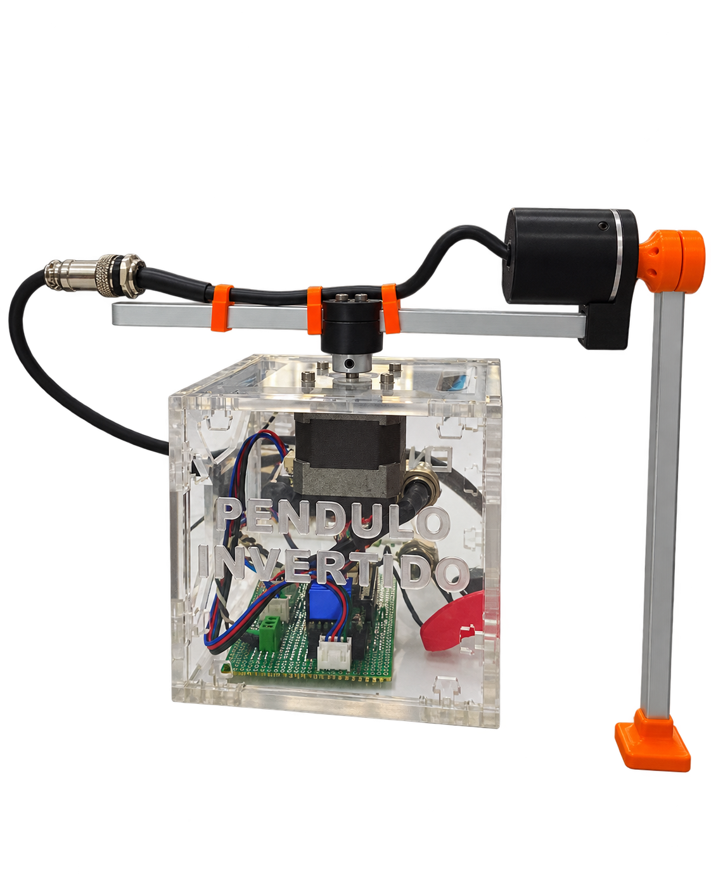
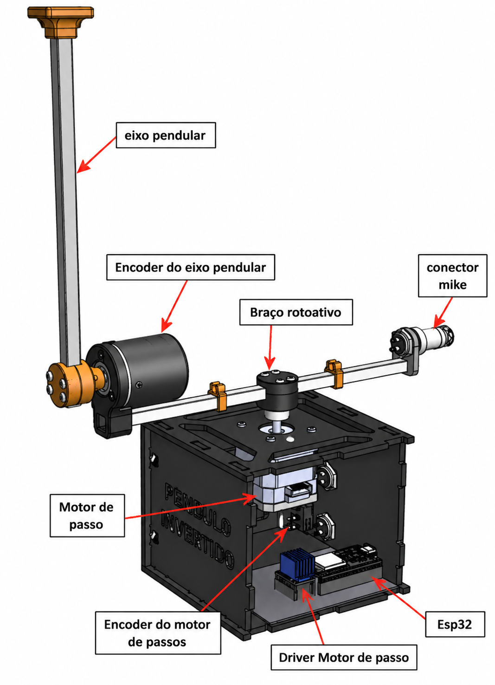
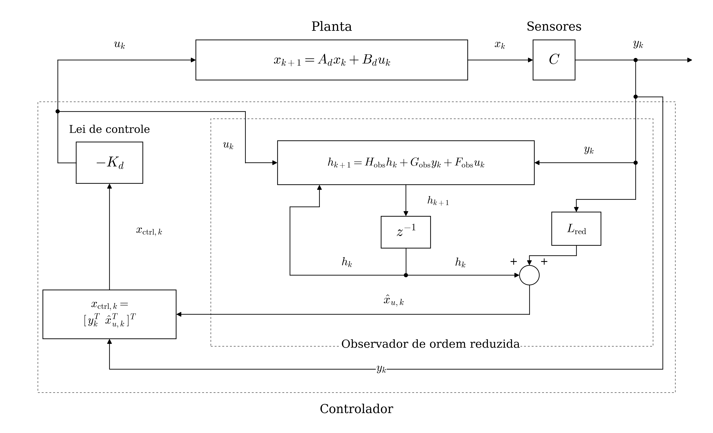
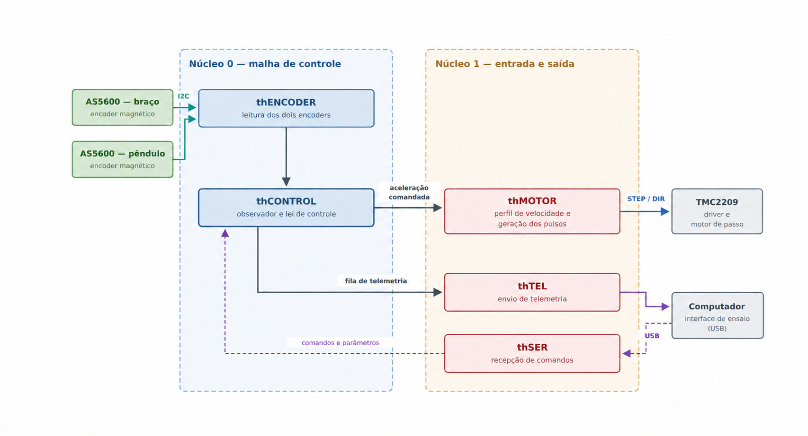
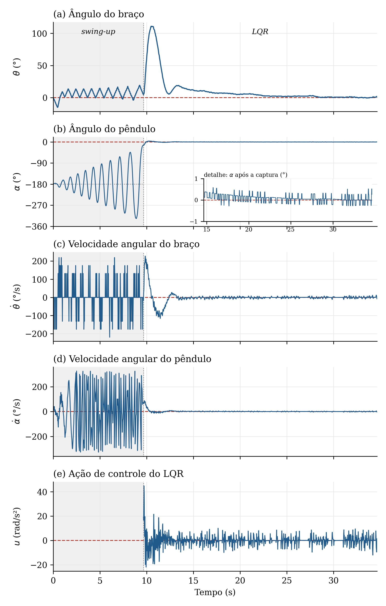
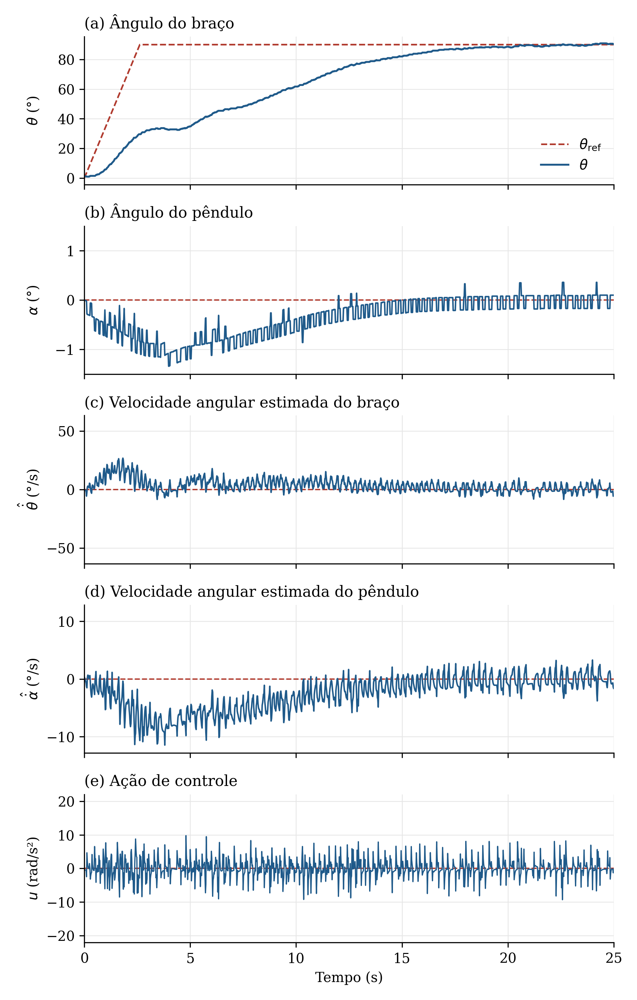
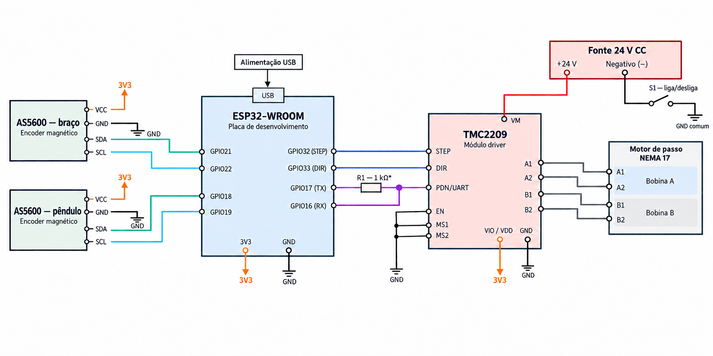

# Pêndulo de Furuta acionado por motor de passo

Construção, modelagem e controle experimental de um **pêndulo invertido rotacional (Furuta)** acionado por um **motor de passo NEMA 17**, com controlador **LQR discreto** e **observador de ordem reduzida** executados em um **ESP32**.

> Trabalho de Conclusão de Curso — Engenharia de Computação, Instituto de Computação (UFAL), 2026.
> Autor: **José Anderson da Silva** · Orientador: Prof. Dr. Ícaro Bezerra Queiroz de Araújo · Coorientador: Prof. Dr. Tiago Alves de Almeida

<p align="center">
  
  &nbsp;&nbsp;
  
</p>

---

## Sumário

- [Como o pêndulo funciona](#como-o-pêndulo-funciona)
- [Resultados](#resultados)
- [Lista de materiais](#lista-de-materiais)
- [Ligações elétricas](#ligações-elétricas)
- [Estrutura do repositório](#estrutura-do-repositório)
- [Firmware (PlatformIO)](#firmware-platformio)
- [Interface e scripts em Python](#interface-e-scripts-em-python)
- [Passo a passo para colocar o pêndulo de pé](#passo-a-passo-para-colocar-o-pêndulo-de-pé)
- [Comandos seriais](#comandos-seriais)
- [Problemas comuns](#problemas-comuns)

---

## Como o pêndulo funciona

O sistema tem duas partes que giram:

- **Braço (θ):** gira no plano horizontal, preso ao eixo do motor de passo.
- **Haste pendular (α):** gira livre na ponta do braço. Ela não tem motor.

O objetivo é manter a haste **em pé (α = 0)**, que é uma posição instável. Como só o braço é acionado, o controlador movimenta o braço para "corrigir" a queda da haste, como quem equilibra uma vassoura na palma da mão.

### Malha de controle

<p align="center">
  
</p>

A cada **2 ms** o ESP32:

1. **Lê os ângulos** θ e α com dois encoders magnéticos **AS5600** (I2C, 12 bits).
2. **Estima as velocidades** θ̇ e α̇ com um **observador de ordem reduzida**, sem derivar o sinal ruidoso dos encoders.
3. **Calcula a ação de controle** com o **LQR**: `u = −K·[θ, α, θ̇, α̇]`. A saída `u` é a **aceleração angular desejada do braço** (rad/s²).
4. **Converte `u` em pulsos** para o driver **TMC2209**: a aceleração é limitada (aceleração e *jerk*), integrada para virar velocidade e transformada em frequência de pulsos STEP (256 micropassos).

### Fases de operação

| Fase | O que acontece |
|---|---|
| **Swing-up** | Com a haste pendurada, o braço oscila de um lado para o outro e "bombeia" energia até a haste subir. |
| **Captura (LQR)** | Quando a haste chega a menos de **15°** da vertical, o LQR assume e a equilibra. |
| **Equilíbrio** | O LQR mantém a haste em pé e o braço na referência θ_ref. O *autozero* corrige pequenos erros de calibração de α. |
| **Queda** | Se a haste passa de **20°**, o LQR é desligado e o swing-up recomeça. |

### Modelo matemático (resumo)

Usando Euler–Lagrange, linearizando em torno de α = 0 e tomando a aceleração do braço como entrada (`u = θ̈`):

```
x = [θ  α  θ̇  α̇]ᵀ
θ̈ = u
α̈ = (3g / 4L)·α + (3r / 4L)·u
```

Com `r = 124,95 mm` e `L = 204,33 mm`, o modelo depende só da geometria (não precisa medir massas). O modelo é discretizado com `Ts = 2 ms` (ZOH). O LQR usa `Q = diag(2500, 3000, 500, 20)` e `R = 1`. Os polos do observador são `−14` e `−5 s⁻¹`.

### Arquitetura do firmware

<p align="center">
  
</p>

O firmware roda sobre **FreeRTOS** nos dois núcleos do ESP32:

| Núcleo | Tarefas |
|---|---|
| **0 (controle)** | leitura dos encoders, observador, LQR / swing-up |
| **1 (E/S)** | atualização do motor (pulsos STEP/DIR), recepção de comandos seriais, envio de telemetria |

---

## Resultados

<p align="center">
  
  &nbsp;&nbsp;
  
</p>

| Ensaio | Resultado |
|---|---|
| Captura após o swing-up | LQR habilitado com α = −13,65°; haste a menos de 1° da vertical em **2,6 s** |
| Reposicionamento do braço em ±90° | haste nunca passou de **1,34°** da vertical durante a manobra |
| Regime permanente | erro médio do braço **< 1,1°**; desvio padrão de α ≈ **0,16°** (cerca de 2 contagens do AS5600) |

---

## Lista de materiais

> **Preencha os links e preços.** Os valores abaixo são as especificações usadas no protótipo.

| # | Qtd. | Componente | Especificação | Link | Preço (R$) |
|---|---|---|---|---|---|
| 1 | 1 | Motor de passo | NEMA 17, 4,2 kgf·cm, 200 passos/volta | | |
| 2 | 1 | Driver de motor de passo | TMC2209 (módulo) | | |
| 3 | 1 | Polia dentada | para o eixo do motor (acoplamento do braço) | | |
| 4 | 2 | Encoder magnético | AS5600 (módulo) | | |
| 5 | 2 | Ímã de magnetização diametral | para o AS5600 | | |
| 6 | 1 | Encoder incremental (só a mecânica) | carcaça, eixo e rolamentos reaproveitados na articulação da haste | | |
| 7 | 1 | Microcontrolador | ESP32-WROOM (placa DevKit V1) | | |
| 8 | 1 | Fonte | 24 V CC | | |
| 9 | 3 | Conector Mike (aviação) | interligações elétricas | | |
| 10 | 1 | Chave liga/desliga | corta o retorno da fonte do motor | | |
| 11 | 1 | Resistor | 1 kΩ (UART do TMC2209) | | |
| 12 | 1 | Placa perfurada, bornes e fios | montagem da eletrônica | | |
| 13 | 2 | Barra de alumínio | seção quadrada (braço e haste pendular) | | |
| 14 | 11 | Parafuso M3 | cabeça abaulada | | |
| 15 | 4 | Parafuso M5 | cabeça abaulada | | |
| 16 | 4 | Porca M5 | travante (Parlock) | | |
| 17 | – | Chapa de acrílico | estrutura (corte a laser) | | |
| 18 | – | Filamento PLA | peças impressas em 3D | | |
| | | | | **Total** | |

---

## Ligações elétricas

<p align="center">
  
</p>

| Componente | Pino do ESP32 | Função |
|---|---|---|
| TMC2209 | GPIO32 | STEP |
| TMC2209 | GPIO33 | DIR |
| TMC2209 | GPIO17 | UART TX (via resistor de 1 kΩ) |
| TMC2209 | GPIO16 | UART RX |
| AS5600 do braço | GPIO21 / GPIO22 | SDA / SCL (barramento I2C 0) |
| AS5600 do pêndulo | GPIO18 / GPIO19 | SDA / SCL (barramento I2C 1) |

- Motor alimentado por **24 V**; eletrônica em **3,3 V** (regulador do ESP32, que é alimentado pela USB).
- **EN, MS1 e MS2** do TMC2209 vão ao **GND** (driver sempre habilitado; micropassos configurados por UART).
- Os **GNDs** da fonte de 24 V e do ESP32 devem estar **interligados**.
- Os dois AS5600 têm o mesmo endereço I2C, por isso cada um fica em um barramento separado.

Para mudar pinos, corrente ou micropassos, edite [`controle/include/config.h`](controle/include/config.h).

---

## Estrutura do repositório

```
pendulo-furuta-tcc/
├── controle/                     # Firmware do ESP32 (projeto PlatformIO)
│   ├── platformio.ini            # Placa, framework e bibliotecas
│   ├── include/
│   │   ├── config.h              # Pinos, períodos, limites e parâmetros principais
│   │   └── *.h                   # Cabeçalhos dos módulos
│   ├── src/
│   │   ├── main.cpp              # Inicialização e criação das tarefas
│   │   ├── encoder.cpp           # Leitura dos dois AS5600
│   │   ├── observer.cpp          # Observador de ordem reduzida
│   │   ├── lqr.cpp               # Lei de controle LQR
│   │   ├── swing_up.cpp          # Rotina para levantar a haste
│   │   ├── control.cpp           # Máquina de estados (parado / swing-up / LQR)
│   │   ├── motor.cpp             # Limites de aceleração/jerk e geração dos pulsos STEP
│   │   ├── driver_tmc.cpp        # Configuração do TMC2209 por UART
│   │   ├── microstep_control.cpp # Troca de micropassos durante o LQR
│   │   ├── fuzzy.cpp             # Supervisor fuzzy de micropassos
│   │   ├── calibration.cpp       # Calibração do zero do pêndulo (salva na flash)
│   │   ├── autozero.cpp          # Ajuste automático do zero durante o equilíbrio
│   │   ├── serial_cmd.cpp        # Comandos recebidos pela serial
│   │   ├── serial_tx.cpp         # Envio de telemetria
│   │   └── params.cpp, filas.cpp # Parâmetros e filas compartilhadas
│   └── docs/                     # Notas sobre o controle de micropassos
│
└── pid_serial_tuner/             # Ferramentas em Python (rodam no computador)
    ├── lqr_tuner/                # Interface gráfica de operação e sintonia
    │   ├── main.py               # ← programa principal da interface
    │   ├── lqr_design.py         # Cálculo do ganho LQR (Riccati discreta)
    │   ├── observer_matrix.py    # Cálculo das matrizes do observador
    │   ├── identificacao_sistema.py # Identificação do modelo a partir das coletas
    │   ├── serial_comm.py        # Comunicação serial com o ESP32
    │   ├── telemetry.py          # Decodificação da telemetria
    │   ├── config_store.py       # Lê/salva config.json
    │   ├── config.json           # Últimos ganhos e parâmetros usados
    │   └── data/                 # Coletas (.csv) e modelos identificados
    ├── simulacao.py              # Simulação do pêndulo com LQR e observador
    ├── plot_coleta.py            # Script auxiliar para gerar gráficos de coletas
    └── requirements.txt
```

---

## Firmware (PlatformIO)

### O que instalar

1. **[Visual Studio Code](https://code.visualstudio.com/)**.
2. A extensão **PlatformIO IDE** (aba *Extensions* do VS Code → buscar "PlatformIO IDE"). Ela baixa sozinha o compilador do ESP32 e as bibliotecas.
3. **Driver USB da placa** (só se o Windows não reconhecer a porta COM): [CP210x](https://www.silabs.com/developers/usb-to-uart-bridge-vcp-drivers) ou [CH340](https://www.wch-ic.com/downloads/CH341SER_EXE.html), conforme o chip da sua placa.

Bibliotecas usadas (instaladas automaticamente pelo `platformio.ini`):

- `teemuatlut/TMCStepper` — configuração do TMC2209
- `stan-reifel/SpeedyStepper`

### Compilar e gravar

**Pelo VS Code:**

1. `File → Open Folder…` e abra a pasta **`controle/`** (não a raiz do repositório).
2. Conecte o ESP32 pela USB.
3. Na barra inferior do VS Code, clique em **✓ (Build)** e depois em **→ (Upload)**.
4. Clique no ícone da tomada (**Serial Monitor**) para ver as mensagens (115200 baud).

**Pelo terminal** (com o PlatformIO Core instalado — `pip install platformio`):

```bash
cd controle
pio run                    # compila
pio run -t upload          # grava no ESP32
pio device monitor         # abre o monitor serial (115200 baud)
```

> Se a gravação não começar, segure o botão **BOOT** da placa quando aparecer `Connecting...`.
> Feche o monitor serial (e a interface Python) antes de gravar: só um programa pode usar a porta por vez.

---

## Interface e scripts em Python

### O que instalar

- **Python 3.10 ou mais recente** ([python.org](https://www.python.org/downloads/)). No Windows, marque **"Add Python to PATH"** na instalação.

### Criar o ambiente e instalar as dependências

**Windows (PowerShell):**

```powershell
cd pid_serial_tuner
python -m venv .venv
.\.venv\Scripts\Activate.ps1
pip install -r requirements.txt
pip install scipy matplotlib pandas      # usados pelos scripts de simulação, identificação e gráficos
```

> Se o PowerShell bloquear o `Activate.ps1`, rode uma vez:
> `Set-ExecutionPolicy -Scope CurrentUser RemoteSigned`

**Linux / macOS:**

```bash
cd pid_serial_tuner
python3 -m venv .venv
source .venv/bin/activate
pip install -r requirements.txt
pip install scipy matplotlib pandas
```

| Pacote | Para que serve |
|---|---|
| `pyserial` | comunicação com o ESP32 |
| `numpy` | cálculos matriciais (LQR e observador) |
| `PySide6` | janela da interface gráfica |
| `pyqtgraph` | gráficos em tempo real |
| `scipy`, `matplotlib`, `pandas` | simulação, identificação do sistema e gráficos |

### Abrir a interface

```bash
cd lqr_tuner
python main.py
```

A interface **LQR Tuner** permite:

- conectar à porta serial do ESP32;
- **INICIAR / STOP** o controle, **Reset θ** e **calibrar α**;
- definir **Q e R**, calcular e enviar o ganho LQR (**Calcular + Aplicar LQR**);
- definir os polos do **observador** e enviar as matrizes (**Calcular + Aplicar OBS**);
- mudar a **referência do braço θ**;
- configurar os **micropassos** do LQR;
- ver gráficos em tempo real e **gravar coletas** em `lqr_tuner/data/coleta_lqr_<data>.csv`;
- enviar comandos manuais pelo terminal serial.

### Outros scripts

| Script | Como rodar | O que faz |
|---|---|---|
| `simulacao.py` | `python simulacao.py` | Simula o pêndulo linearizado com LQR e observador (parâmetros no topo do arquivo). |
| `lqr_tuner/identificacao_sistema.py` | `python identificacao_sistema.py` | Identifica um modelo discreto a partir das coletas em `data/`; salva matrizes e gráficos em `data/modelos_identificados/`. |
| `plot_coleta.py` | `python plot_coleta.py` | Gera gráficos de coletas (ajuste os nomes dos arquivos no dicionário `FILES`). |

---

## Passo a passo para colocar o pêndulo de pé

1. **Grave o firmware** no ESP32 (seção [Firmware](#firmware-platformio)).
2. **Ligue a fonte de 24 V** e a chave liga/desliga do motor.
3. **Abra a interface** (`python main.py`), escolha a porta COM e clique em **Conectar**.
4. Com a haste **pendurada e parada**, clique em **Calibrar α**. O zero fica salvo na flash e não precisa ser refeito a cada vez que ligar.
5. Confira se os ganhos LQR e as matrizes do observador estão aplicados (**Calcular + Aplicar LQR** e **Calcular + Aplicar OBS**).
6. Clique em **INICIAR**. O braço faz o *swing-up*, a haste sobe e o LQR assume automaticamente.
7. Opcional: com a haste equilibrada, mude a **referência θ** (ex.: 90°) e clique em **Aplicar θ ref**.
8. Clique em **STOP** para parar.

> ⚠️ Mantenha as mãos e objetos longe do braço durante o swing-up: ele gira rápido e pode dar voltas maiores que 90°.

---

## Comandos seriais

Os comandos podem ser enviados pelo terminal da interface ou por qualquer monitor serial (115200 baud, terminados em `\n`).

| Comando | Descrição |
|---|---|
| `START` / `STOP` | inicia (swing-up → LQR) / para o controle |
| `LQR kθ kα kθ̇ kα̇` | define os ganhos do LQR |
| `TH <graus>` / `THR <rad>` | referência do braço |
| `TH?` | mostra a referência atual |
| `RTH` | zera a posição do braço |
| `AL <rad/s²>` | limite de aceleração do braço |
| `CALIB` | calibra o zero do pêndulo (haste pendurada) e salva na flash |
| `ZTOP <graus>` / `ZSAVE` / `ZERO?` | ajuste fino do zero com a haste em pé / salvar / consultar |
| `AZ 0` / `AZ 1` / `AZ?` / `AZRESET` | desliga / liga / consulta / apaga o autozero |
| `OLR`, `OF`, `OG`, `OH`, `OAPPLY` | carregam e aplicam as matrizes do observador |
| `MSAUTO 0/1` / `MSMAN <n>` / `MS?` | micropassos automáticos, manuais (8 a 256) ou consulta |

---

## Problemas comuns

| Problema | O que verificar |
|---|---|
| A porta COM não aparece | cabo USB com dados (não só de carga) e driver CP210x/CH340 |
| `Access denied` ao gravar ou conectar | outro programa está usando a porta (monitor serial, interface, Arduino IDE) |
| O motor não gira | fonte de 24 V ligada, chave liga/desliga, GND comum entre fonte e ESP32 |
| O motor vibra e perde passos | corrente do TMC2209 e limites `ARM_ACCEL_MAX_RAD_S2` / `ARM_JERK_MAX_RAD_S3` em `config.h` |
| O braço deriva para um lado com a haste em pé | zero de α mal calibrado: refaça **Calibrar α** ou use **Calibrar α topo** |
| A leitura de um ângulo não muda | fiação I2C do AS5600 e distância do ímã ao sensor |

---

## Licença

Defina aqui a licença do projeto (por exemplo, MIT).
